## About me

I design **AI agent systems** and build them on top of real engineering work in **embedded firmware**.
My current tooling centers on **Hermes Agent**, **Oh My Pi** and **Tern**: native agent interfaces,
terminal plugins, multi-provider workflows and persistent LLM memory.
I also build an autonomous GitHub agent daemon and workflows that build, flash and debug STM32 firmware on real hardware.

This page is the portfolio view of that work. Public repositories are linked; private ones are marked.

 Illustrative animation, not captured terminal output.

## AI & agent systems

<table>
<tr>
<td width="50%" valign="top">

### [hermes-tern](https://github.com/Emirfs/hermes-tern)
  

Hermes Agent in Tern's native UI. `hermes tern` renders conversations, tool calls, approvals and subagents as real UI components, with resumable sessions, live background-job charts and linked pull requests.

</td>
<td width="50%" valign="top">

### [tern-plugins](https://github.com/Emirfs/tern-plugins)
 

Tern plugins and Oh My Pi extensions: cross-profile account limits, pane profile labels, independent split columns, switchable UI mods, active-account status and versioned artifacts beside the chat.

</td>
</tr>
<tr>
<td width="50%" valign="top">

### [conclave](https://github.com/Emirfs/conclave)
 

Local, daemon-first workspace for multiple AI coding providers. Claude Code, Codex, Antigravity and Ollama sessions live as cards on an infinite canvas. Cards relay, review and debate each other's answers, and work keeps running after the UI closes.

</td>
<td width="50%" valign="top">

### ghd
 

Autonomous agent daemon that watches my GitHub repository fleet. It connects local AI CLIs to controlled GitHub work: implementing issues, reviewing PRs, fixing review findings, syncing docs and proposing conflict resolutions.

</td>
</tr>
<tr>
<td width="50%" valign="top">

### [mnemo](https://github.com/Emirfs/mnemo)
 

Persistent, portable, cross-AI memory over a plain Markdown vault. Push-based auto-recall injects relevant past work into the model's context without being asked. Backed by a private vault of my own engineering notes.

</td>
<td width="50%" valign="top">

### [WID — Works In Debug](https://github.com/Emirfs/WID)
 

Claude Code agent system for STM32 development. Agents build, flash and debug on real hardware. My RF firmware-update work, including [FirmwareUpdate_RF](https://github.com/Emirfs/FirmwareUpdate_RF), was developed and tested with it.

</td>
</tr>
<tr>
<td width="50%" valign="top">

### [multi-ai-manager](https://github.com/Emirfs/multi-ai-manager)
  

Desktop control panel for Claude, Codex, Gemini, Ollama and Mistral CLIs. Task queue with dependencies, approvals, shared memory, agent profiles, and token and cost estimates.

</td>
<td width="50%" valign="top">

### [opus-5-5-playbook](https://github.com/Emirfs/opus-5-5-playbook)
 

Agent rule and prompting skill for Claude Opus 5.5, derived from the official guide. Works with Oh My Pi, Claude Code and Cursor.

</td>
</tr>
<tr>
<td width="50%" valign="top">

### [ai-news-hub — Neural Pulse](https://github.com/Emirfs/ai-news-hub)
 

Autonomous AI and frontier-tech journal. Hourly dispatches, trending open-source models and multi-language briefings, produced without manual editing.

</td>
</tr>
</table>

## AI usage

Recorded usage by model vendor, including **Hermes Agent** and every **Oh My Pi** profile. Refreshed every 3 hours.

Sources &amp; counting

- [Tokscale submissions](https://tokscale.ai/u/Emirfs) from my machine every 3 hours, scanning every Oh My Pi profile and the session backup of retired ones.
- Submitted day totals never decrease, so usage stays counted after its local logs are deleted.
- Tokens include cache reads. Cost is the estimated list-price equivalent, not actual spend; some records are unpriced or lack usage events.
- The workflow re-renders the card from the Tokscale API every 3 hours.

## AI harnesses

**Workspace:** [Tern](https://stencil.so/tern) · **Local models:** [Ollama](https://ollama.com/)

## GitHub activity

<picture>
  <source media="(prefers-color-scheme: dark)" srcset="https://raw.githubusercontent.com/Emirfs/Emirfs/output/snake.svg" />
  
</picture>

